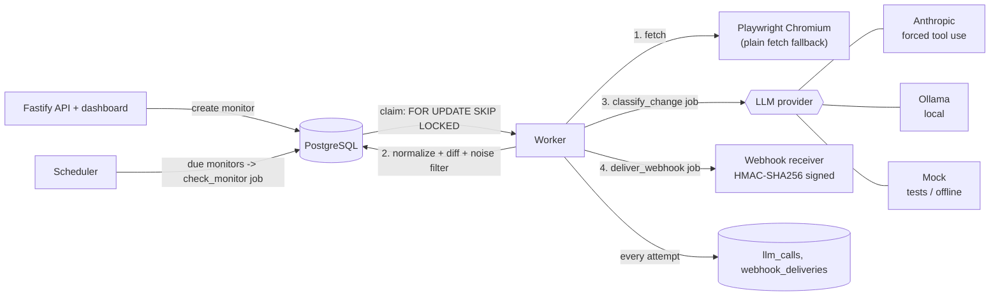

# Website Watchdog

Register a URL. A background worker fetches it on a schedule, diffs the text against the last snapshot, filters out noise (timestamps, counters, ads), asks an LLM whether what is left is a change worth knowing about, and sends a signed webhook if it is.

This is a portfolio project. It is a working, tested system, not a product: there are no users, and I have not run it against a live Anthropic account or a real Discord/Slack channel (see [Limitations](#limitations)). I built it to show backend and AI-automation engineering on top of my QA background, so most of the effort went into the parts that go wrong in real systems: retries, duplicates, bad LLM output and testing.

TypeScript (strict, ESM), Node 20+, Fastify, PostgreSQL, Playwright, Vitest, zod.

## How it works



The pipeline is three job types, each one small and idempotent:

1. `check_monitor`: fetch the page, normalise the text, hash it. If the hash matches the last snapshot, stop. Otherwise store the snapshot, diff it, run the deterministic noise filter and, if anything substantive is left, create a `changes` row and a `classify_change` job. The snapshot, the change and the next job are written in one transaction.
2. `classify_change`: send the surviving diff lines (plus the unchanged heading above them) to the LLM, validate the answer with zod, store `{ meaningful, category, severity, summary }`. If `meaningful`, enqueue a webhook job.
3. `deliver_webhook`: POST a signed JSON body (it has `text` for Slack and `content` for Discord, plus a `watchdog` object with the structured fields).

The deterministic pre-filter masks volatile tokens (clock times, "5 minutes ago", visitor counters, build hashes, copyright years) and cancels lines that are identical after masking. Prices, stock words and other real text are deliberately not masked. If nothing is left, the change is stored as `filtered_noise` and the LLM is never called. In the eval set this resolves 9 of 40 cases for free.

## Reliability decisions and why

| Decision | Why |
| --- | --- |
| **Postgres as the job queue, claimed with `FOR UPDATE SKIP LOCKED`** | One fewer moving part than Redis, and jobs commit in the same transaction as the data that creates them. `SKIP LOCKED` lets several workers poll the same table without blocking each other or taking the same job. Tested with 8 concurrent claimers over 60 jobs: every job claimed exactly once. |
| **Leases + reaper for crash recovery** | A claim sets `locked_until`. If a worker dies mid-job, the lease expires and the job goes back to `queued`. Attempts are kept, so a job that crashes the worker every time ends up dead-lettered instead of looping forever. |
| **Idempotency keys** | Jobs have a unique `idempotency_key` (`classify:{monitor}:{snapshot hash}`, `webhook:{change}`, `check:{monitor}:{slot}`). Enqueueing twice is a no-op, so a retried job or two overlapping schedulers cannot create duplicate work. Handlers are also written to be safe to re-run (a changed page is stored once, an already-classified change is skipped). |
| **Exponential backoff with full jitter** | Retries wait a random time between 0 and `min(cap, base * 2^attempt)`. The growth gives a failing dependency room to recover; the jitter stops many failed jobs from retrying at the same moment. A `Retry-After` header from a 429 overrides the computed delay. |
| **Max attempts and a dead-letter state** | After N attempts a job becomes `dead` with its last error kept. Errors that cannot be fixed by retrying (an LLM refusal, a webhook 4xx other than 408/429) go dead immediately. `GET /health` reports the `dead` count. |
| **HMAC-SHA256 webhook signatures** | The receiver can verify the request came from us and was not modified. The signed string is `timestamp.body`, so a captured request cannot be replayed with a new timestamp (receivers should reject timestamps older than 5 minutes; `verifySignature` does). Comparison is constant-time. |
| **Webhook dedupe at the database level** | Every attempt is logged in `webhook_deliveries`. A partial unique index allows only one `success` row per change, so even two racing workers cannot record a double delivery. Delivery is still at-least-once (a crash between the receiver's 200 and our log write could resend), so each request carries a stable `X-Watchdog-Delivery` id for the receiver to dedupe on. |
| **LLM output is validated with zod, every time** | Anthropic is called with a forced tool (`tool_choice`), Ollama with a JSON-schema `format`, and both results still go through the same zod schema (enums, `summary` 1-200 chars, no extra fields, `noise` cannot be `meaningful`). Malformed JSON, schema violations, refusals, timeouts and 429s each map to an explicit `LlmError` kind with a retry decision. |
| **SDK retries off, queue retries on** | The Anthropic client runs with `maxRetries: 0`. Retries are visible in the `jobs` table, bounded and backed off, instead of hidden inside the SDK. |
| **Every LLM call is logged** | `llm_calls` stores provider, model, latency, input/output tokens, estimated cost and outcome, for successes and failures. Cost is an estimate from a price table in `src/llm/cost.ts`, overridable by env. |
| **Cheap filter before the expensive call** | Noise is removed deterministically first, and the LLM only confirms what remains. |
| **Provider fallback is loud** | `auto` picks Anthropic if `ANTHROPIC_API_KEY` is set, else Ollama if it is reachable with the configured model, else the mock. The choice is logged at startup, with a warning when it is the mock. |
| **SSRF guard** | Monitor URLs must be http(s) and not an obvious loopback/private host unless `ALLOW_PRIVATE_HOSTS=true`. |

## Run it locally

Needs Node 20+ and Docker.

```bash
npm install
npx playwright install chromium     # rendered fetching; without it the plain-fetch fallback is used
docker compose up -d --wait         # Postgres on localhost:5432
cp .env.example .env                # optional; defaults work. Note: nothing loads .env automatically,
                                    # so use `export` or `node --env-file=.env` if you want to set values
npm run dev                         # migrations run on start; dashboard at http://localhost:3000
```

Add a monitor from the dashboard or the API:

```bash
curl -X POST localhost:3000/monitors -H 'content-type: application/json' \
  -d '{"url":"https://example.com/pricing","webhookUrl":"https://discord.com/api/webhooks/...","intervalSeconds":300}'
curl localhost:3000/monitors
curl localhost:3000/changes
curl -X POST localhost:3000/monitors/<id>/check     # check now instead of waiting
curl localhost:3000/health
```

| Env var | Meaning |
| --- | --- |
| `LLM_PROVIDER` | `auto` (default), `anthropic`, `ollama`, `mock` |
| `ANTHROPIC_API_KEY`, `ANTHROPIC_MODEL` | Anthropic key; model defaults to `claude-haiku-5-5` |
| `OLLAMA_URL`, `OLLAMA_MODEL` | Defaults `http://localhost:11434`, `llama3.2` |
| `WEBHOOK_SECRET` | HMAC key for outgoing webhooks |
| `DEFAULT_WEBHOOK_URL` | Used for monitors without their own webhook URL |
| `FETCH_MODE` | `auto` (Playwright, falling back to plain fetch), `playwright`, `http` |

## Tests

```bash
npm run typecheck
npm run lint
npm test                    # unit (Vitest), no services needed
npm run test:integration    # needs Postgres: docker compose up -d --wait
npm run test:e2e            # needs Postgres and Chromium
npm run eval                # offline, mock provider
```

- **Unit (82 tests):** normalise/diff/HTML-to-text, noise filter, backoff and jitter, HMAC sign/verify (tamper, wrong secret, replay), zod parsing of malformed LLM output, Anthropic and Ollama error mapping with stubbed clients (refusal, 429 + Retry-After, timeout, 5xx, missing tool call), `llm_calls` record contents, idempotency keys, SSRF guard, config, eval scoring.
- **Integration (33 tests, real Postgres):** concurrent claiming, idempotent enqueue, retry with backoff, dead-letter, crash recovery via lease expiry, the worker loop, the full check -> classify -> webhook-job pipeline with a fake fetcher and mock LLM, webhook signing and dedupe against a local receiver (including 5xx, 429, 4xx, network error and a race between two workers), and the REST API. They use a separate `watchdog_test` database on the same server. If Postgres is not reachable they skip with a loud message instead of failing.
- **End-to-end (5 Playwright tests):** the real app runs as a child process against its own database. A fixture site whose content the test changes, and a local webhook receiver, stand in for the outside world. The tests assert: price change -> classified by the mock -> webhook received with a valid signature; unchanged content sends nothing; a timestamp-only change is filtered; a change in JavaScript-rendered content is detected (which a plain fetch would miss); and the dashboard shows it all.
- **CI** (`.github/workflows/ci.yml`): typecheck, lint, unit, integration (Postgres service container), e2e, and the eval gate.

## Evals

`evals/dataset.json` holds 40 hand-written before/after pairs: price (6), availability (6), policy (5), content (5), outage (5) and noise (13), including awkward ones such as a date that changes next to a real policy edit, an ad body on its own line, a review count that drifts, and a price that stays the same while its "checked" date moves.

`npm run eval` runs each pair through the same path as production (normalise, diff, noise filter, then the provider), scores category accuracy, yes/no accuracy, severity accuracy, per-category precision and recall, average latency and total cost, writes a report to `evals/reports/`, and exits non-zero if category accuracy is below `EVAL_MIN_ACCURACY` (default `0.8`). Pick a provider with `EVAL_PROVIDER=mock|ollama|anthropic` or `--provider=`.

```bash
npm run eval                                            # mock, offline
EVAL_PROVIDER=ollama OLLAMA_MODEL=llama3.2 npm run eval  # local model
EVAL_PROVIDER=anthropic ANTHROPIC_API_KEY=... npm run eval
```

Sample report (**mock provider**, `evals/reports/example-mock.md`):

| Metric | Value |
| --- | --- |
| Category accuracy | 88% |
| Meaningful (yes/no) accuracy | 95% |
| Severity accuracy (meaningful, category correct) | 63% |
| Avg latency per LLM call | 0 ms |
| Total cost (estimated) | $0.0000 |
| Resolved by deterministic pre-filter (no LLM call) | 9 / 40 |

| Category | Support | Precision | Recall |
| --- | --- | --- | --- |
| price | 6 | 86% | 100% |
| availability | 6 | 100% | 100% |
| policy | 5 | 100% | 60% |
| content | 5 | 56% | 100% |
| outage | 5 | 100% | 80% |
| noise | 13 | 100% | 85% |

How to read this: the mock is a keyword heuristic, not a model, so this number shows that the pipeline, scoring and CI gate work offline. It says nothing about how good Claude or a local model is. The misses are the interesting part: the mock cannot recognise a policy change with no policy keyword, or a maintenance page that avoids the usual words. The eval already paid for itself once: its first run showed the LLM only saw the changed lines, with no heading, so policy changes were unclassifiable. I now pass the unchanged lines directly above the change as context. I did not run the eval against a real model for this README (no API key, and Ollama was not running on the machine), so there is no real-model table here.

## Layout

```
src/
  api/        Fastify server + routes        public/   static dashboard (no framework)
  db/         pool, migration runner, SQL    jobs/     handlers + scheduler
  queue/      claim / retry / dead-letter    llm/      providers, zod schema, cost, logging
  webhooks/   signing + delivery             fetch/    Playwright, plain HTTP, URL guard
  text/       normalise, diff, noise filter
evals/        dataset, scorer, runner, reports
tests/        unit/  integration/  e2e/
```

## Limitations

- The Anthropic provider is tested against a stubbed client only; I have not called the live API. The model id (`claude-haiku-5-5`) is the one the project was specified with, and the cost figures are placeholder per-token prices you can override (`ANTHROPIC_PRICE_INPUT_PER_MTOK`, `ANTHROPIC_PRICE_OUTPUT_PER_MTOK`). Check both before relying on them.
- The webhook body follows the Slack and Discord shapes (`text` / `content`) but has not been sent to either service.
- Webhook delivery is at-least-once, not exactly-once (see above).
- The SSRF guard checks hostnames only, not DNS results, so a public name pointing at a private IP would pass.
- No authentication on the API and dashboard; it is meant to run on a trusted network.
- Page text is compared as whole lines. Pages that reflow text between lines produce noisy diffs.
- Snapshots are stored in full and never pruned.
